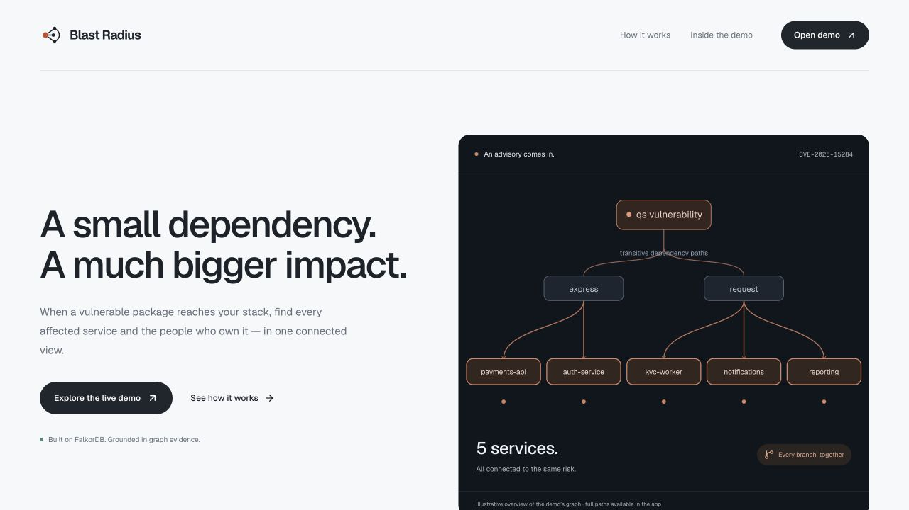
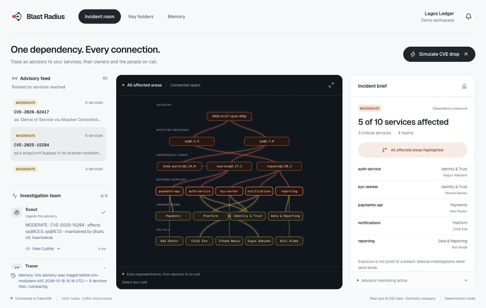

# Blast Radius

**A CVE just dropped. Which of your services are exposed, through which dependency path, who's on call, and has this happened before?**

Blast Radius is an incident workspace built on **FalkorDB**. Four sequential investigation stages (Scout, Tracer, Cartographer, Commander) query one graph joining **real npm data** (resolved dependency trees from deps.dev, advisories from OSV.dev, public maintainer handles) to a **synthetic company graph** (teams, people, services, on-call, architecture decisions and past incidents). All affected layers light up together. Select an evidence-linked finding to inspect its path in 3D. Scheduled advisory checks can notify the configured admin with concise next steps.

The public demo runs deterministic graph-based output without a model key. Optional LLM narration can rewrite the Commander brief; the other stages are query-driven tools, not four autonomous LLM agents.

> Built solo for **Graph Hacks: Context for AI Agents** (WeMakeDevs × FalkorDB), Oct 15–18, 2026.

**Tracks entered:** Track 1 · Agents That Act on Connected Data, Track 2 · Agent Memory and Coordination, Track 3 · Company Brain

| | |
|---|---|
| Live site | [blast-radius-murex.vercel.app](https://blast-radius-murex.vercel.app) |
| Incident workspace | [Open the demo](https://blast-radius-murex.vercel.app/app) |
| Submitted video · 33-second overview | [Watch on YouTube](https://youtu.be/WtkidDnVEtA) |
| MCP endpoint | `https://blast-radius-murex.vercel.app/api/mcp` (Streamable HTTP, JSON-RPC) |





---

## Why a graph (and why it breaks without FalkorDB)

The question "are we exposed?" is a multi-hop question: `Advisory → vulnerable Version ← DEPENDS_ON* ← direct dependency ← DEPLOYS ← Service ← OWNS ← Team`, then `Service ← ON_CALL ← Person`, `Service ← ABOUT ← Decision`, `Service ← INVOLVED ← Incident`. Every agent tool is a Cypher query against FalkorDB, agent memory is stored as nodes and edges in the same graph, and the UI is a live view of it. Take FalkorDB out and there is nothing left: no exposure, no owners, no memory, no brief.

What the graph finds in the demo dataset (all real npm data):
- **CVE-2025-15284 (qs)** reaches **5 of 10 services, 3 of them tier-1**, through two separate routes: `express@4.17.1 → qs@6.7.0` and `request@2.88.2 → qs@6.5.5`. None of those services lists `qs` directly.
- **The cached npm metadata lists one maintainer handle on 54 packages in the tree, including 29 with no other listed maintainer; those packages reach 8 of 10 services.** PageRank over `DEPENDS_ON` plus service reachability measures concentration in this snapshot, not current publish permissions or likelihood of compromise.

## The agents

| Agent | Does | Graph work |
|---|---|---|
| **Scout** | Pulls the advisory, opens an `(:Investigation)`, recalls prior investigations of the same advisory | `MATCH (a:Advisory)-[:AFFECTS]->(v)`, `FOLLOWS_UP` link to the last run |
| **Tracer** | Finds every service that reaches a vulnerable version and the shortest path | `shortestPath((s:Service)-[:DEPLOYS\|DEPENDS_ON*]->(v))` |
| **Cartographer** | Company brain: owners, on-call, ADRs, past incidents for the exposed services and packages | multi-pattern `OPTIONAL MATCH` over Team / Person / Decision / Incident |
| **Commander** | Writes the incident brief: who to page, fix path, decisions in play, history, maintainer risk, change since last time | writes `(:Finding)` nodes with `EVIDENCE` edges; `SUPERSEDES` the previous brief |

Agents hand off through **shared state in the graph** (`Investigation`, `Finding`, `Agent` nodes), not through prompts. Every run is persisted, so a later session (or a different agent, or Claude via MCP) can recall it.

**Two modes:**
- **LLM mode:** set `AI_GATEWAY_API_KEY`, `OPENAI_API_KEY` or `OPENROUTER_API_KEY`. The Commander writes the brief with an OpenAI-compatible model, constrained to the graph facts. A **grounding guard** keeps only claims whose evidence ids exist in the graph result and whose `pkg@version` / CVE / GHSA / ADR / INC tokens appear in the facts. These checks are a partial safeguard, not a proof that every natural-language assertion is correct. Ungrounded claims are dropped and counted in the UI. If fewer than 3 grounded claims survive, or the model call fails (bad key, timeout), the Commander falls back to deterministic mode and shows the reason. `/api/health` probes the model every 10 minutes, so the header badge reflects whether AI mode is actually live.
- **Deterministic mode (default):** same graph tools, template brief. Fully reproducible and needs no key.

Full reference: [Graph model](docs/GRAPH_MODEL.md) · [Cypher query catalog](docs/QUERIES.md) · [Product audit](submission/AUDIT.md).

## Graph data model

```
(:Company)-[:HAS_TEAM]->(:Team)-[:OWNS]->(:Service)-[:DEPLOYS]->(:Version)
(:Person)-[:MEMBER_OF]->(:Team)          (:Person)-[:ON_CALL]->(:Service)
(:Package)-[:HAS_VERSION]->(:Version)-[:DEPENDS_ON]->(:Version)
(:Maintainer {npm})-[:MAINTAINS]->(:Package {maintainerCount})
(:Advisory {id, aliases, severity, summary, fixed})-[:AFFECTS]->(:Version)
(:Incident)-[:INVOLVED]->(:Service)      (:Incident)-[:CAUSED_BY]->(:Package)   (:Incident)-[:LED_BY]->(:Person)
(:Decision)-[:ABOUT]->(:Service|:Package) (:Decision)-[:DECIDED_BY]->(:Person)

// agent memory (Track 2)
(:Investigation {id, advisory, status, started, serviceCount})-[:ABOUT]->(:Advisory)
(:Investigation)-[:FOLLOWS_UP]->(:Investigation)
(:Investigation)-[:HAS_FINDING]->(:Finding {kind, text, ts, data})<-[:WROTE]-(:Agent)
(:Finding)-[:EVIDENCE]->(any node)       (:Finding)-[:SUPERSEDES]->(:Finding)
```

Seeded display graph: 1,522 nodes and 2,955 relationships (509 package versions, 464 packages, 375 maintainers, 135 advisories, 10 services, 12 people, 5 teams, 6 incidents, 5 ADRs), plus memory nodes that grow with every investigation.

## Key Cypher queries

All of them are in [`src/lib/queries.ts`](src/lib/queries.ts), and the UI's **Cypher** toggle shows the exact query each agent ran.

**Blast radius: services, shortest path, owner, on-call**
```cypher
MATCH (a:Advisory {id:$id})-[:AFFECTS]->(v:Version)
MATCH (s:Service)-[:DEPLOYS|DEPENDS_ON*1..12]->(v)
WITH DISTINCT s, v
WITH s, v, shortestPath((s)-[:DEPLOYS|DEPENDS_ON*]->(v)) AS p
MATCH (t:Team)-[:OWNS]->(s)
OPTIONAL MATCH (oc:Person)-[:ON_CALL]->(s)
RETURN s.id AS service, s.tier AS tier, t.name AS team, oc.name AS oncall, v.key AS vulnerable,
       length(p) AS hops, [n IN nodes(p) | labels(n)[0] + ':' + coalesce(n.key, n.id)] AS path
ORDER BY tier, hops
```

**Who holds the keys: PageRank over the dependency graph, rolled up per maintainer, with reachability**
```cypher
CALL algo.pageRank('Version','DEPENDS_ON') YIELD node, score
MATCH (pk:Package)-[:HAS_VERSION]->(node)
MATCH (s:Service)-[:DEPLOYS|DEPENDS_ON*1..12]->(node)
MATCH (m:Maintainer)-[:MAINTAINS]->(pk)
WITH m, pk, max(score) AS rank, collect(DISTINCT s.id) AS svcs
WITH m, sum(rank) AS influence, collect(pk.name) AS pkgs, collect(svcs) AS svcLists,
     sum(CASE WHEN pk.maintainerCount = 1 THEN 1 ELSE 0 END) AS soloPkgs
UNWIND reduce(acc = [], x IN svcLists | acc + x) AS sid
WITH m, influence, pkgs, soloPkgs, collect(DISTINCT sid) AS services
RETURN m.npm AS maintainer, influence, size(pkgs) AS packages, soloPkgs, size(services) AS serviceCount
ORDER BY serviceCount DESC, influence DESC LIMIT $limit
```

**Company brain: decisions and incident history for the exposed services**
```cypher
MATCH (s:Service) WHERE s.id IN $services
OPTIONAL MATCH (d:Decision)-[:ABOUT]->(s)
OPTIONAL MATCH (d)-[:DECIDED_BY]->(dp:Person)
WITH s, collect(DISTINCT {id:d.id, title:d.title, text:d.text, by:dp.name}) AS decisions
OPTIONAL MATCH (i:Incident)-[:INVOLVED]->(s)
OPTIONAL MATCH (i)-[:LED_BY]->(lead:Person)
RETURN s.id AS service, decisions, collect(DISTINCT {id:i.id, title:i.title, date:i.date, lead:lead.name}) AS incidents
```

**Agent memory: open an investigation that remembers the last one**
```cypher
MATCH (a:Advisory {id:$advisory})
OPTIONAL MATCH (prev:Investigation)-[:ABOUT]->(a)
WITH a, prev ORDER BY prev.started DESC
WITH a, collect(prev)[0] AS last
CREATE (i:Investigation {id:$id, advisory:$advisory, status:'open', started:$now})-[:ABOUT]->(a)
FOREACH (_ IN CASE WHEN last IS NULL THEN [] ELSE [1] END | CREATE (i)-[:FOLLOWS_UP]->(last))
RETURN i.id AS id, last.id AS previous, last.serviceCount AS previousServiceCount
```

## MCP

`POST /api/mcp` is a stateless MCP server (Streamable HTTP, JSON responses). Tools:
- `top_advisories`
- `search_advisories`
- `blast_radius`
- `who_owns`
- `maintainer_risk`
- `single_maintainer_packages`
- `run_investigation` (runs all four agents and persists findings)
- `list_investigations`

Each result carries the Cypher it ran. Set `MCP_API_KEY` to require `Authorization: Bearer …`.

```json
{ "mcpServers": { "blast-radius": { "url": "https://blast-radius-murex.vercel.app/api/mcp" } } }
```

`docker-compose.yml` also starts the **official FalkorDB MCP server** (`@falkordb/mcpserver`, read-only) on `:3005`, so an assistant can run its own Cypher against the same graph.

## Run it

For the verified Mac setup and deployment steps, see [DEPLOYMENT.md](DEPLOYMENT.md). Node 22 is required.

**Docker (everything):**
```bash
docker compose up --build        # app on :3000, FalkorDB on :6379, FalkorDB Browser on :3001, MCP on :3005
# in a second terminal, initialize once:
docker compose exec app npm run seed
```

**Local dev:**
```bash
npm install
docker run -p 6379:6379 falkordb/falkordb:latest   # or: npm run falkordb:local  (no Docker, Linux x64)
cp .env.example .env.local                         # Mac defaults use port 6389; set 6379 for Docker
npm run seed                                       # DELETES existing graph/history; offline from data/cache
npm run dev                                        # http://localhost:3000
```

**FalkorDB Cloud + Vercel:**
1. Create a free FalkorDB Cloud instance.
2. Set `FALKORDB_HOST`, `FALKORDB_PORT`, `FALKORDB_USERNAME` and `FALKORDB_PASSWORD` (or `FALKORDB_URL`) locally, then `npm run seed` to load it.
3. Add the same variables (plus an optional model key) to Vercel and deploy.
4. Set the repo variable `APP_URL` so `.github/workflows/keepalive.yml` pings `/api/health` every 3 hours. Free instances stop after a day idle.

`npm run seed:refresh` re-fetches live data from deps.dev, OSV and npm instead of using the committed cache.

## Data

- **Public, real:** resolved npm dependency graphs from [deps.dev](https://deps.dev) for 25 pinned package versions, advisories from [OSV.dev](https://osv.dev) queried per exact resolved version, and package publishers from the npm registry. **Only npm usernames are stored. Maintainer emails are dropped at fetch time.** Raw responses are cached in `data/cache/` so the seed is reproducible.
- **Synthetic:** the company "Lagos Ledger" in `data/company.json`: teams, people, services, on-call, incidents and ADRs. All fictional.
- The seed also creates one back-dated deterministic investigation, so the Memory tab has a prior run to recall on a fresh database.

## Stack

- Next.js 15 (App Router, Node runtime routes), TypeScript, Tailwind v4
- `falkordb` Node client
- react-force-graph-3d with an UnrealBloom pass, Framer Motion, lucide icons
- OpenAI-compatible chat completions (Vercel AI Gateway / OpenAI / OpenRouter), optional
- Playwright for screenshots

## AI tools disclosure

AI coding assistants helped implement, debug, test, document and deploy this project and prepare its demonstration media. The participant supplied the product direction: show all affected layers of a dependency incident at once, notify the configured admin, and make the alert short and actionable. The implementation and verification record are included here; the participant should review the architecture and queries and be prepared to explain them. The live demo currently uses deterministic graph-based output. When a model key is configured, an LLM rewrites only the Commander's brief; evidence and entity-token checks reject unsupported references, but do not establish that every natural-language statement is correct.

## Project layout

```
data/company.json         synthetic company graph
data/cache/*.json         cached public npm/OSV/deps.dev responses
scripts/seed.ts           destructive graph rebuild + explicit demo-memory seed
src/lib/queries.ts        every Cypher query (agent tools)
src/lib/agents.ts         Scout → Tracer → Cartographer → Commander
src/lib/tools.ts          MCP tool registry
src/app/api/*             graph, investigate (NDJSON stream), risk, investigations, mcp, health
src/components/*          war-room UI and 3D graph
```

## Incident map, monitoring and admin email

Select an advisory or simulate an incident to highlight all connecting dependency branches, affected services, teams and on-call people simultaneously. Evidence clicks narrow the view; **Show all affected areas** restores the overview. Email links open the same incident through `?advisory=…`.

The protected `/api/monitor` endpoint checks installed package versions against [OSV querybatch](https://google.github.io/osv.dev/post-v1-querybatch/). The GitHub `dependency-monitor` workflow runs approximately every 30 minutes (scheduler delays are possible). It imports up to three newly discovered advisories per scan, records persistent deduplicated alerts and attempts one pending email per run. This monitors published vulnerability exposure, not intrusion detection. Initial seeded advisories are the baseline; it does not email all historical vulnerabilities. Package inventory remains the synthetic seeded company, not a connected customer repository.

At `/setup`, the deployment owner signs in with `ADMIN_TOKEN`, confirms the server-configured admin email, and chooses whether to enable notifications. Public visitors cannot configure email, run monitoring or send tests. Admin keys remain only in page memory. Configure these server-side settings:

- `ADMIN_TOKEN`: at least 32 random characters; owner-only setup access.
- `MONITOR_TOKEN`: separate random secret, also stored as the GitHub Actions secret of the same name.
- `APP_URL`: canonical deployed HTTPS address; also a GitHub repository variable.
- `ADMIN_EMAIL`: private server-side recipient. The graph stores the notification preference, never the address. Change this value in deployment settings to change the recipient.
- `RESEND_API_KEY` and `ALERT_FROM`: [Resend](https://resend.com/docs/api-reference/emails/send-email) key and verified sender.

Optionally set `RESEND_TEMPLATE_ID` to a published template with string variables `DETAILS` and `MORE`; long alerts fall back to complete plain text. The official Resend SDK sends with a stable idempotency key. For own-inbox testing, `Blast Radius <onboarding@resend.dev>` works only with your Resend account email; other recipients require a verified sending domain.

Confirm the configured recipient and enable notifications before pressing **Send test email**. The test runs a real, clearly marked synthetic incident through alert persistence and delivery. Replaying the same test request ID returns the existing accepted result without sending again. The UI reports provider acceptance, not inbox delivery. No real provider key or admin email is bundled. Without them, alerts persist in-app and say pending/setup required. Public simulations never send email. Email goes to the configured admin, with the fictional service owners listed for context. This is single-workspace owner setup, not a multi-tenant signup system.

Alert records and notification preferences are excluded from the public graph. The recipient remains in server environment settings; loading settings removes any legacy recipient property from the graph. The public alert list contains advisory IDs and delivery states, never the recipient address. Avoid reseeding: it would erase settings and history. Rotate admin/monitor keys through deployment settings if needed.

Seeded prior incidents and architecture decisions are fictional examples, including their historical dates. They are demonstration context, not pre-hackathon product activity.
