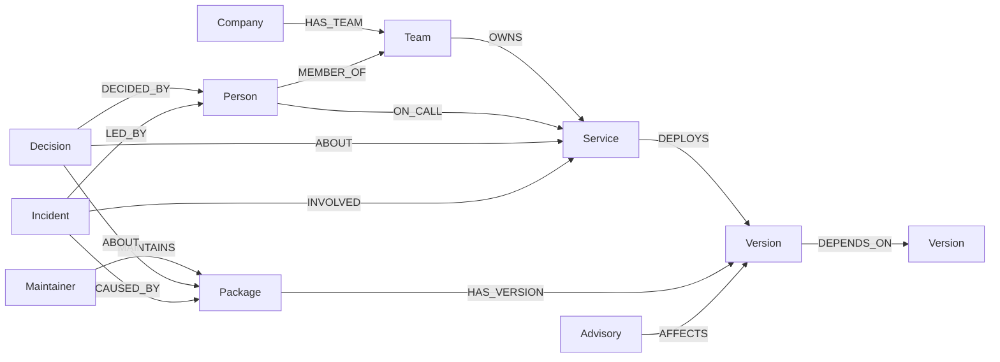
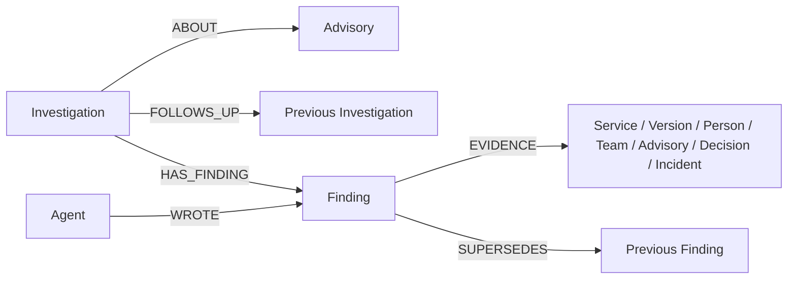

# Blast Radius graph model

FalkorDB is the source for exposure, ownership context, investigation history and alert state. The default graph is `blast_radius`, configurable with `FALKORDB_GRAPH`. The seed script rebuilds that graph; it is not a migration and deletes existing history and settings. Use a dedicated demo database.

Implementation: [seed](../scripts/seed.ts), [query registry](../src/lib/queries.ts), [investigation workflow](../src/lib/agents.ts), [complete incident map](../src/lib/impact.ts), [alerts](../src/lib/alerts.ts) and [monitor](../src/lib/monitor.ts).

## Data and provenance

| Layer | Source | What is represented |
|---|---|---|
| Dependency inventory | Public deps.dev dependency responses cached in `data/cache/depsdev.json` | Exact resolved npm versions and their directed dependency edges for the synthetic services' pinned direct dependencies |
| Vulnerabilities | Public OSV query matches and advisory records in `data/cache/osv-hits.json` and `osv-vulns.json` | Advisory-to-version matches; summaries, severity, aliases, published dates, fix records and source links |
| Maintainers | Public npm registry version metadata in `data/cache/npm-maintainers.json` | npm handles associated with the selected package-version metadata; emails are dropped |
| Company | `data/company.json` | Fictional Lagos Ledger teams, people, services, on-call responsibilities, incidents and decisions |
| Investigation memory | Actual app runs, plus one explicitly backdated seed run | Workflow status, findings, citations and links between investigations |
| Operational state | App and monitor writes | Alert deduplication and delivery state, monitor leases and notification preferences |

The committed snapshot has 509 versions, 464 packages, 375 maintainer handles, 135 advisories, 10 services, 5 teams, 12 people, 6 fictional incidents, 5 decisions, one company and 4 workflow agents: **1,526 base nodes**. The public visualization excludes Agent, Investigation, Finding and operational nodes, so it has **1,522 nodes** before an advisory refresh. Investigation and alert counts grow at runtime. These counts were checked against the local seeded graph on 18 October 2026; they are dataset facts, not a scalability benchmark.

The snapshot is reproducible. `npm run seed:refresh` fetches current public data and can change these counts. The vulnerable versions are records in the graph, not dependencies installed into the Blast Radius web application.

## Domain schema

`DEPENDS_ON` points from a dependent version to the version it consumes. A service has `DEPLOYS` edges to its direct dependencies. An advisory points to each affected exact version. Traversing from the service through DEPLOYS/DEPENDS_ON therefore establishes dependency reachability to an advisory's affected version.

| Label | Lookup key | Relevant properties |
|---|---|---|
| Company | `name` | `tagline` |
| Team | `id` | `name`, synthetic `channel` |
| Person | `id` | synthetic `name`, `role` |
| Service | `id` | `name`, `tier`, `desc` |
| Package | `name` | `maintainerCount`, `vulnerable` |
| Version | `key` = `package@version` | `pkg`, `ver`, `direct`, `vulnerable` |
| Maintainer | `npm` | public package-maintainer handle |
| Advisory | `id` | `summary`, `details` when seeded, `severity`, `aliases`, `published`, `url`, `fixed` |
| Decision | `id` | `title`, `text` |
| Incident | `id` | `title`, `date`, `summary`, `package` |

The seed creates property indexes for Package.name, Version.key, Service.id, Team.id, Person.id, Maintainer.npm, Advisory.id, Incident.id, Decision.id, Investigation.id, Finding.id and Agent.name. These are indexes, not a claim of uniqueness constraints. Node creation is controlled by the seed/application; dynamic alerts use `MERGE` by stable ID.

## Investigation memory

- `Investigation`: `id`, `advisory`, `status`, `started`, `mode`; on completion, `closed`, `serviceCount` and `severity`.
- `Finding`: `id`, `kind`, `text`, `ts` and `data` (serialized JSON). Its supported evidence entities are constrained by `Q.writeFinding`.
- `Agent`: a seeded name and role for Scout, Tracer, Cartographer or Commander.

The application coordinates four sequential stages. Scout reads the advisory and opens a run linked to the latest prior investigation. Tracer persists exposed service paths. Cartographer adds owners, decisions and incident context. Commander persists the brief and closes the run. The optional model affects Commander's prose; it does not select arbitrary queries or independently verify exploitation.

A new brief is connected to previous brief findings through `SUPERSEDES`; the current implementation links every new brief finding to every prior brief finding of that kind. It is run-level replacement history, not semantic claim-by-claim matching. The seed creates one genuine deterministic result and moves its timestamp back 26 hours for an explicitly synthetic memory demonstration.

## Incident map and operational state

The map returns the union of dependency edges on routes to affected versions, then includes the advisory, teams and on-call people. For the featured `GHSA-6rw7-vpxm-498p` case, it returns 20 nodes and 21 links covering all 5 exposed services. The shortest-path query remains available for concise individual evidence.

- `Alert`: stable `id`, `advisory`, `created`, `status`, `isTest`, `services`; delivery adds a temporary `lease`/`owner`, `providerId` and `error`. Ordinary IDs hash the advisory plus sorted service IDs. Test IDs are explicit request IDs, so an intentional new test can be sent while a replay is deduplicated.
- `Monitor {id:'osv'}`: lease owner and expiry, last `checked` timestamp and `error`.
- `AlertSettings {id:'admin'}`: notification preferences. Recipient storage is a release-sensitive boundary; see the final implementation in `src/lib/alerts.ts` and [rules notes](../submission/RULES.md).

These operational nodes are not part of the public graph visualization. The public alert endpoint exposes advisory/delivery metadata, not admin recipient details. Notification delivery uses one configured admin address; fictional on-call people appear as context, not real message recipients. `accepted` means the provider accepted the request, not that the mailbox received it.

The scheduled monitor queries OSV for seeded versions, imports at most three new advisory candidates and attempts one queued email per invocation. Existing seeded advisory matches are the baseline. Public incident simulation runs an investigation; it does not send email. This is vulnerability advisory monitoring, not attack telemetry or intrusion detection.

## Scope and limitations

- Dependency matching is bounded by the current inventory and the query's 12-hop exposure search. Missing inventory or longer routes can be missed.
- Shared version nodes collapse identical versions used by different services; this is not an installation-instance or environment-specific SBOM model.
- `maintainerCount` comes from cached npm metadata, not a live permission audit. PageRank and reachability measure concentration in this snapshot, not likelihood of compromise or a maintainer's trustworthiness.
- The application does not prove runtime exploitability, automatically patch dependencies or page individual fictional staff.
- Memory is for one public synthetic workspace. Tenant isolation and customer-repository import are not implemented.
- The optional LLM guard checks evidence IDs and recognized entity tokens. It is useful filtering, not a proof of every claim's semantic correctness.

Release update: the admin recipient is now held in the private `ADMIN_EMAIL` server environment variable. `AlertSettings` stores only the enabled preference; the first protected settings/monitor read removes a legacy `email` property. Public graph data remains public npm/OSV records and synthetic company context. Live migration status is tracked in the release record.
